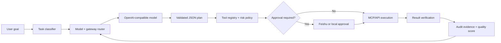

# MCP Task Runner

<p align="center">
  <strong>Safe, task-aware AI automation across models, gateways, and MCP tools.</strong><br>
  <sub>让 AI 会干活，但不能乱干；干完还要证明自己干对了。</sub>
</p>

<p align="center">
  <a href="https://github.com/HerShin5/mcp-task-runner/actions/workflows/test.yml"></a>
  
  
  
  <a href="README.md">中文文档</a>
</p>

MCP Task Runner is a safety-first AI automation runner. It classifies a task, selects a capable model and a healthy gateway, generates a structured plan, enforces tool risk policy, requests approval for non-read-only actions, verifies the outcome, and records evidence.

It is **not** a Dify clone, a drag-and-drop workflow editor, or a standalone MCP server. It is the safety and routing layer between an AI agent and the tools that can change the real world.

## Why this project?

Tool-using agents are powerful but easy to trust too much:

- A model may choose an unsuitable or degraded model route.
- A cheap gateway may not carry the requested model.
- A tool may return `success` even when the real operation failed.
- A write or restart action may need human approval.
- A gateway may be reachable but blocked by an allowlist, out of balance, or unhealthy.

MCP Task Runner treats these as runtime decisions instead of hidden assumptions.

## The core loop

```text
user goal
  -> classify task requirements
  -> filter model capabilities
  -> filter gateway/model availability and health
  -> estimate cost and select a route
  -> generate a structured plan
  -> validate tools and risk locally
  -> request approval when required
  -> execute
  -> verify the real result
  -> record evidence and quality signals
```

## Architecture



## What makes it different?

### Task-aware model routing

A routing model or offline classifier converts natural language into bounded requirements such as:

```json
{
  "task_type": "ops_agent",
  "minimum": {
    "reasoning": 3,
    "tool_calling": 4,
    "structured_output": 4
  },
  "quality_floor": "high",
  "cost_preference": "balanced"
}
```

A cheap model is not rejected because it is cheap. It is rejected only when it cannot meet the task capability floor.

### Dynamic gateway selection

Gateways are configuration data, not hard-coded integrations. Each gateway may expose multiple models, group keys, pricing bands, health data, and access prerequisites.

The selector considers:

- model availability;
- capability fit;
- short/long-context pricing;
- estimated input/output cost;
- latency and error rate;
- balance and concurrency limits;
- quality/degradation state;
- circuit-breaker state.

### Observable quality checks

The project does not claim to see hidden provider-side changes. It measures behavior instead:

- fixed benchmark tasks;
- structured-output validity;
- expected tool calls;
- verification success;
- task completion;
- unexpected refusals;
- latency regressions;
- request errors.

Routes become `healthy`, `degraded`, `suspect`, or `blocked`. Blocked routes are excluded; degraded routes are penalized.

### Fail-closed execution

The model cannot define its own permissions. Tool risk comes from the local registry. Non-read-only actions require approval by default, and a successful transport response is not treated as proof of business success.

## MVP scenario

```text
"Check whether Windows-MCP is healthy; if it is broken, propose a repair."
```

The first Windows-MCP adapter is read-only and checks an already-running Streamable HTTP endpoint for MCP initialization and advertised tools. Local process and TCP diagnostics stay separate from MCP protocol discovery. No service is started and no desktop action is performed by the diagnostic plan.

## Quick start

```powershell
git clone https://github.com/HerShin5/mcp-task-runner.git
cd mcp-task-runner
python -m pip install -e ".[dev]"
python -m pytest -q
```

Run the offline demos without a gateway or API key:

```powershell
python -m mcp_task_runner.cli orchestrate-demo 检查 Windows-MCP 并修复
python -m mcp_task_runner.cli orchestrate-demo 总结 这段文本
python -m mcp_task_runner.cli plan-validate examples/plan.json
```

The offline demos show the intended behavior:

- complex operations select a stronger capable model;
- simple text transformation selects a cheaper eligible model;
- generated plans are validated before execution;
- no network or system side effect is performed.

## Configure your own gateways

Copy `providers.example.json` to a local `providers.json` and fill in your own values. `providers.json` is ignored by Git.

```json
{
  "providers": [
    {
      "name": "example-gateway",
      "base_url": "https://api.example.com/v1",
      "api_key": "",
      "group_key": "",
      "models": [
        {
          "name": "example-model",
          "pricing": {
            "short": {"input": 0.02, "output": 0.02},
            "long": {"input": 0.02, "output": 0.02},
            "long_context_threshold": null
          }
        }
      ]
    }
  ]
}
```

The project does not require a specific model vendor. Users can configure OpenAI-compatible gateways and add their own models, providers, group keys, pricing, and model capability profiles. The control API supports `MCP_TASK_RUNNER_API_TOKEN` Bearer authentication and approval state can be persisted in SQLite.

Management-plane data can be attached through a redacted snapshot. For local development, a `providers.management.json` file next to `providers.json` can describe groups, models, pricing multipliers, health, balance, and concurrency without storing tokens. See `examples/management-snapshot.example.json`. A production adapter should update the same snapshot shape only through an authorized management API; management failures must not bypass ordinary gateway health checks.

When attached to routing, disabled, blocked, offline, or model-missing groups are excluded; group/model multipliers affect estimated cost and reported error rates add a reliability penalty. Without a management snapshot, the existing health probe and manual pricing configuration remain the source of truth, so a temporary management-plane outage does not silently authorize a route.

Runtime adapters use `ManagementSnapshotStore` for refresh and TTL handling: an expired snapshot or failed refresh is removed from routing instead of reusing old balance or health data. `GenericHttpManagementAdapter` only reads JSON and keeps the normalized snapshot in memory; it does not write management tokens to config, logs, or fixture files. Provider-specific field mapping belongs in a separate adapter.

`GatewayCatalog` is the unified entry point: the `providers-health` and `route-select` CLI commands now use it for health checks, management refresh, and routing. Code callers can use `select_model_and_gateway()` to apply capability, health, management, cost, quality, and latency filters from one consistent catalog snapshot.

## CLI and local API

```powershell
python -m mcp_task_runner.cli providers-health --config providers.json
python -m mcp_task_runner.cli route-select --config providers.json --input-tokens 120000 --output-tokens 8000
python -m mcp_task_runner.cli mcp-tools --url http://127.0.0.1:8766/mcp --token-file C:\path\to\mcp-auth-key.txt
python -m mcp_task_runner.cli approval-demo
python -m mcp_task_runner.cli approval-demo --approve
```

The dependency-free development API exposes:

```text
GET  /health
GET  /diagnostic-plan
GET  /approval-demo/pending
POST /approval-demo
POST /approval-callback
```

Start it with:

```powershell
python -c "from mcp_task_runner.api import serve; serve()"
```

## Security boundary

- Arbitrary shell execution is not enabled.
- Non-read-only tools fail closed and require approval.
- Model output cannot bypass the registry or risk validator.
- API keys, Base URLs, group keys, management tokens, and cookies stay outside Git.
- Browser login cookies are not treated as permanent product credentials.
- Real gateway testing should use a low-risk key and no production tools.

See [SECURITY.md](SECURITY.md) for the full policy and [ARCHITECTURE.md](ARCHITECTURE.md) for trust boundaries.

## Project status

This is an active MVP/research project. The core routing, capability profiles, quality signals, structured planning, approval seam, Windows-MCP read-only client, gateway configuration, and tests are implemented. Feishu production approval, provider management-plane adapters, broader platform adapters, and a full execution console are next-stage work.

## Documentation

- [中文文档 / Chinese README](README.md)
- [Architecture / 架构](ARCHITECTURE.md)
- [Security / 安全](SECURITY.md)
- [Contributing / 贡献](CONTRIBUTING.md)
- [Model profiles example](model_profiles.example.json)
- [Benchmark tasks example](benchmarks.example.json)

## License

MIT. See [LICENSE](LICENSE) if one is added by the project owner.
